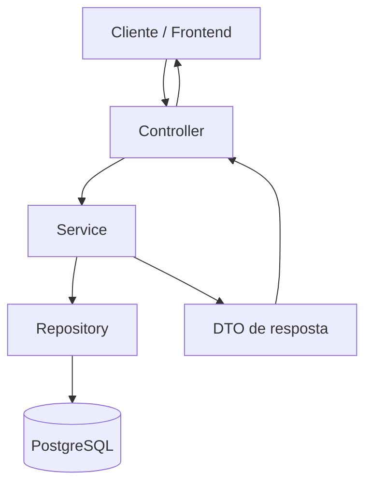

# Arquitetura do backend

## Visão geral

O Hub Operacional é uma API Java baseada em Spring Boot. O código separa o recebimento das requisições, as regras de negócio e a persistência dos dados.

O diagrama representa o fluxo geral. Nem toda operação precisa produzir um DTO de resposta específico, e o fluxo exato varia conforme o endpoint.

## Camadas

### Controller

Os controllers são anotados com `@RestController` e mapeiam caminhos HTTP. Por exemplo, os controllers de documentos e movimentações financeiras usam o prefixo `/atlashub`.

Responsabilidades:

- receber parâmetros de rota, query parameters e corpos de requisição;
- chamar o service correspondente;
- converter o resultado em uma resposta HTTP;
- retornar códigos adequados quando uma operação falha.

Controllers não devem concentrar regras de negócio complexas.

### Service

Os services concentram as operações da aplicação. Exemplos existentes no código:

- `UsuarioService`: criação de usuário e verificação das credenciais;
- `DocumentoService`: operações com documentos;
- `MovimentacoesFinanceirasService`: operações e consultas financeiras;
- `RegistroService`: operações relacionadas a registros.

A injeção de dependências é feita pelos construtores, permitindo que o Spring forneça as dependências necessárias.

### Repository

Os repositories fazem a comunicação com a persistência, usando Spring Data JPA. Isso evita que os services precisem implementar manualmente operações comuns de consulta e gravação.

### Model / Entity

As entidades representam dados persistidos. Entre as entidades identificadas no código estão `Usuario`, `Registro`, `Documentos` e `MovimentacoesFinanceiras`.

Os relacionamentos e as colunas devem ser consultados nas próprias entidades e no diagrama do banco. Esta documentação não presume cardinalidades que ainda não foram verificadas.

### DTO

DTOs definem o formato dos dados que entram ou saem da API, sem exigir que a entidade JPA seja exposta diretamente em todas as respostas.

## Persistência e schema

A aplicação usa PostgreSQL e JPA/Hibernate. No ambiente de deploy, a configuração conhecida utiliza validação do schema (`ddl-auto=validate`): a aplicação verifica se o schema existente é compatível, em vez de criar ou atualizar automaticamente todas as tabelas.

Antes de modificar o schema em um ambiente compartilhado ou de produção:

1. confira as entidades e os relacionamentos;
2. faça backup quando aplicável;
3. planeje a alteração do banco;
4. valide em um ambiente separado antes de aplicar em produção.

O diagrama entidade-relacionamento será documentado em uma página específica depois de conferir a versão atual do diagrama.

## Tratamento de erros

Algumas operações capturam exceções específicas e retornam `404 Not Found` quando o recurso solicitado não existe. Erros de entrada ou de processamento podem produzir outras respostas HTTP. O comportamento completo deve ser verificado por endpoint.

## Boas práticas para contribuição

- Mantenha controllers, services, repositories e entidades com responsabilidades distintas.
- Use DTOs para definir contratos da API.
- Injete dependências por construtor.
- Não versionar credenciais, chaves privadas ou dados reais.
- Atualize esta documentação quando rotas, entidades ou regras de negócio mudarem.
