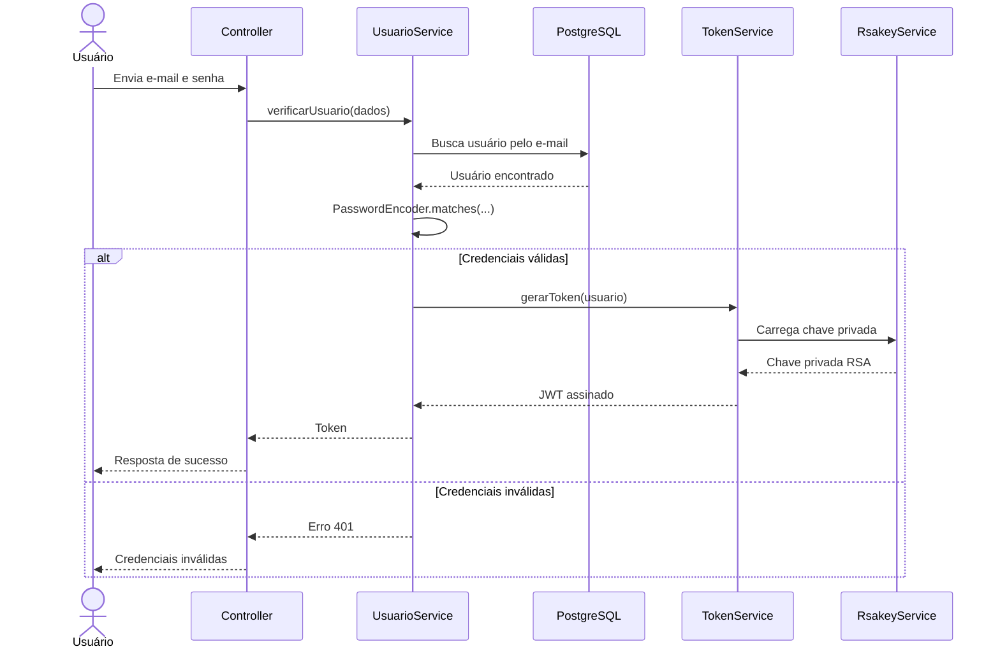

# Autenticação e segurança

## Visão geral

O backend utiliza Spring Security, um `PasswordEncoder` para conferir senhas e JWT assinado com RSA para autenticação baseada em token.

O fluxo de login identificado no código é:

O diagrama descreve o caminho de autenticação implementado em `UsuarioService`. A validação de um JWT em requisições protegidas é realizada pela configuração de segurança e deve permanecer coerente com o algoritmo e a chave pública configurados.

## Senhas

Ao criar um usuário, o service transforma a senha recebida com `PasswordEncoder.encode(...)` antes de persistir o usuário. No login, usa `PasswordEncoder.matches(...)` para comparar a senha informada com o hash armazenado.

A senha original não deve ser armazenada em texto puro nem registrada em logs.

## JWT e RSA

- **Chave privada:** usada para assinar os tokens. Deve permanecer secreta e acessível somente ao processo autorizado a emitir tokens.
- **Chave pública:** usada para verificar a assinatura dos tokens. Pode ser distribuída aos componentes que precisam validar tokens.
- **RS256:** combina RSA com SHA-256 para assinatura e verificação.
- **Expiração:** os tokens devem ter um prazo de validade e a API deve rejeitar tokens expirados.

A chave privada nunca deve ser enviada ao GitHub, incluída na imagem Docker ou compartilhada com o frontend. Forneça-a ao ambiente de execução por um mecanismo seguro de secrets.

## Configuração de ambiente

O serviço de chaves usa as variáveis de ambiente:

- `RSA_PRIVATE_KEY_PATH`: caminho do arquivo que contém a chave privada;
- `RSA_PUBLIC_KEY_PATH`: caminho do arquivo que contém a chave pública.

Definir uma variável de caminho não cria o arquivo. O arquivo precisa existir no ambiente em que a aplicação executa, com o conteúdo no formato esperado pelo código e permissões adequadas.

As credenciais do PostgreSQL e quaisquer outros segredos também devem ser fornecidos por configuração segura do ambiente, nunca como valores fixos versionados.

## Registro de usuários

O fluxo de criação em `UsuarioService` associa o usuário a um registro localizado pelo token recebido no DTO. Esse token de registro é diferente do JWT de autenticação.

O acesso ao endpoint de registro deve ser protegido de acordo com a política de autorização da aplicação. Antes de alterar essa política, confira a configuração atual em `SecurityConfig` e valide o comportamento com testes.

## Recomendações de segurança

- Não exponha senhas, tokens completos ou chaves privadas em logs.
- Não versione arquivos de chave privada nem credenciais de banco.
- Use HTTPS nos ambientes acessados pela rede.
- Valide assinatura, expiração e demais claims relevantes dos JWTs.
- Mantenha as permissões dos endpoints alinhadas aos papéis de usuário.
- Se uma chave privada ou credencial for exposta, considere-a comprometida e faça a rotação.
- Não inclua dados pessoais reais em exemplos ou testes públicos.

Esta página descreve o fluxo identificado no código e não substitui uma auditoria de segurança. Claims, validade exata do JWT e regras de autorização devem ser confirmadas na implementação atual antes de serem tratadas como especificação definitiva.
